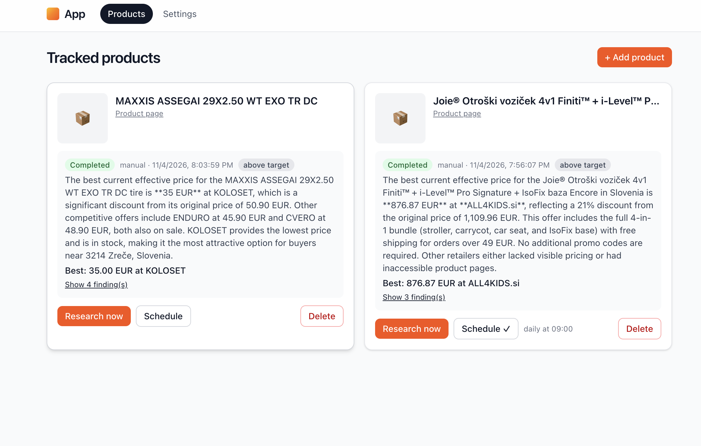

# Mistral Purchasing App

[](https://docs.mistral.ai/studio/apps/overview)
[](LICENSE)
[](pyproject.toml)
[](apps/web/package.json)

A [Mistral Studio app](https://docs.mistral.ai/studio/apps/overview) that tracks products you want
to buy and researches their current prices for you — near your location, on demand or on a
schedule you set per product.

## Screenshot

The main "Tracked products" screen — each card shows the last research run's status, best current
price and store (vs. the original price), the other offers found, and actions to research again,
set a schedule, or delete:



## What this is, and how it's made

This repository is a **Mistral Studio app**: an app brings the resources for a use case into one
deployable project — a frontend, an API, a database, and workflow workers — with hosting,
authentication, and access control provided by Studio. See the
[Apps overview](https://docs.mistral.ai/studio/apps/overview) for the concept and lifecycle.

It was made as follows:

- **Scaffolded with the Mistral CLI**: `mistral init mistral-purchasing-app --preset app` creates
  the web frontend, Python API, Postgres database, and workflow worker (follow the
  [Quickstart](https://docs.mistral.ai/studio/apps/quickstart)).
- **Extended with capabilities** from the `@mistralai-capabilities` registry (v0.1.61): FastAPI
  backend, Mistral Workflows, Postgres, TanStack Start frontend, and Apps deployment — declared in
  `mistral.json` and `.mistral/capabilities.json`.
- **Built with [Vibe](https://vibe.dev)**, Mistral's coding agent (see the merged `vibe/*`
  branches), and developed locally with `mistral dev`.
- **Deployed to Studio with `mistral deploy`** and optionally published to the Vibe catalog with
  `mistral apps publish` (see [Deploy](https://docs.mistral.ai/studio/apps/deploy) and
  [Publish to Vibe](https://docs.mistral.ai/studio/apps/publish-to-vibe)).

The business logic is one durable **Mistral Workflows** workflow, `price-research`
(`apps/worker/src/worker/workflows/price_research.py`): it loads the product and the user's
location settings, identifies the product from its photo with a vision model
(`mistral-small-latest`), sends a web-search agent (`mistral-large-4` with Mistral's
built-in `web_search` tool) to find current offers near the user, parses the offers into
structured findings, and persists the run and findings in Postgres. All database and model calls
happen inside workflow activities; the entrypoint only sequences them.

## What it does

- **Settings screen** (`/settings`): your preferred location (address and optional coordinates),
  the search radius in km, and your currency. Stored per user in Postgres (`user_settings`).
- **Main screen** (`/`): the tracking list of your products, each showing the details of the last
  research run (status, best price and store, whether the target price was reached, and the full
  list of offers found).
- **Add-product dialog**: add a product by uploading a photo of it, or a photo URL, plus the store
  page where you saw it, a product URL you enter manually, an optional target price, and free-form
  extra AI context. Optionally start the first price research immediately.
- **Edit product**: from the product page, edit its name, links, target price, or the extra AI
  context (and remove the uploaded photo) at any time via `PATCH /api/v1/products/{id}`.
- **Manual research**: a "Research now" button per product triggers a research run right away.
- **Custom schedule per product**: repeat the research on a cron expression (UTC) or a fixed
  interval, enabled/paused from the app. Schedules are Mistral Workflows schedules; the app keeps
  them in sync in `product_schedules`.

## Architecture

Modules are declared in [`mistral.json`](mistral.json):

- `apps/web` — TanStack Start frontend (Bun/NX), served at `/`. File-based routes; the typed API
  client in `src/api/generated` is generated from the FastAPI OpenAPI spec
  (`bunx nx run fastapi-tanstack-start:gen-types`).
- `apps/api` — FastAPI backend, served at `/api`. File-based routers under
  `src/api/routers/api/v1`, all behind the gateway caller-auth rule: the gateway token is resolved
  to a principal id via `/v1/whoami`, and every row is scoped to it. Endpoints: settings
  get/put, product CRUD + photo + research history + manual research trigger + schedule
  get/put/delete.
- `apps/worker` — durable workflow worker (Mistral Workflows platform) running the
  `price-research` workflow described above.
- `postgres` — managed Postgres module.
- `packages/py/db` — SQLModel models + accessors + Alembic migrations. Tables: `user_settings`,
  `products`, `research_runs`, `price_findings`, `product_schedules`.
- `packages/py/{env,utils,cli}` — shared settings/environment, utilities, and CLI (pre-start,
  migrations).

Research runs are recorded in `research_runs` (with the workflow execution id), and each offer in
`price_findings`. Scheduled runs are fired by Mistral Workflows schedules whose input carries
`{product_id, user_id, trigger: "schedule"}`.

## Quickstart: run your own copy locally

Prerequisites: `git`, [`uv`](https://docs.astral.sh/uv/), Docker (for the local Postgres),
Bun 1.4.0 (pinned in `package.json`), and the
[Mistral CLI](https://docs.mistral.ai/studio/cli) (`curl -fsSL https://mistral.ai/cli/install.sh | bash`).

```bash
git clone https://github.com/DirendAI/mistral-purchasing-app.git
cd mistral-purchasing-app
bun run install-all        # bun install + uv sync (tools/install.sh); required once after cloning
mistral login
# set MISTRAL_API_KEY in the generated .env (gitignored — never commit it)
docker info >/dev/null     # start Docker first: the local Postgres runs in Docker
mistral dev                # starts gateway, api, worker, web, and the database
```

Open the printed URL (e.g. `http://mistral-purchasing-app.apps.localhost:8080`). Without
`bun run install-all` the web module fails with `vite: command not found`, because
`node_modules` and `.venv` are gitignored.

See [Local development](https://docs.mistral.ai/studio/apps/local-development) for API access,
logs, and working with a coding agent.

## Deploy your own instance

`mistral deploy` builds the **pushed commit** of the `origin` remote and deploys it to Studio:

```bash
# create an empty repository in your GitHub account/org, then:
git remote add origin https://github.com/YOUR-ORG/mistral-purchasing-app.git
git push -u origin HEAD
# connect GitHub to your Mistral account and install the Mistral GitHub app on the repo
mistral login
mistral deploy             # select your organization/workspace when prompted
```

After the first deployment, set `MISTRAL_API_KEY` in the app's **Secrets** tab in Studio, on each
module that needs it (api and worker). The CLI never uploads `.env`.

Note on `mistral.json`: the committed `deployment` block binds this repository to the authors'
Studio app (organization/workspace/app IDs). To deploy your own instance, delete that block
before your first `mistral deploy` — the CLI then creates a **new app in your own
organization** and writes the new binding. See [Deploy](https://docs.mistral.ai/studio/apps/deploy).

### Publish to Vibe

Once your instance is deployed, make it available in the Vibe app catalog:

```bash
mistral apps publish       # reads the deployment binding in mistral.json
```

See [Publish to Vibe](https://docs.mistral.ai/studio/apps/publish-to-vibe). The deployed URL works
whether or not the app is published.

## Configuration and secrets

- `.env` is generated by the Mistral CLI from the installed capabilities and is **gitignored**.
  Set `MISTRAL_API_KEY` there for local development.
- `.env.example` declares the names of app-owned variables only — it holds no values and nothing
  loads it. Do not copy it over `.env`.
- In production, secrets live in the **Secrets** tab of the app in Studio, per module.
  Never commit credentials: `.env` is ignored, and `mistral deploy` refuses to upload `.env*`.

## Development

```bash
bun run install-all

# Python tests
bash tools/uv.sh run --with pytest --with pytest-asyncio -- pytest apps/api/tests packages/py/db/tests apps/worker/tests -o asyncio_mode=auto
# workflow determinism rules
bunx nx run worker:semgrep
# generated web client must match the API
bash tools/gen-types.sh --check
# web tests + types + build
cd apps/web && bun run test && bunx tsc --noEmit -p tsconfig.json && cd ../..
bunx nx run web:build
```

Layout:

```
mistral.json                  # app manifest: modules, routes, dev/deploy commands
.mistral/                     # CLI state: capabilities, registry, generated-file hashes
apps/web                      # TanStack Start frontend
apps/api                      # FastAPI backend (routers under src/api/routers/api/v1)
apps/worker                   # Mistral Workflows worker (workflows/price_research.py)
packages/py/db                # SQLModel models, accessors, Alembic migrations
packages/py/env               # typed settings per module
packages/py/utils             # shared logging / mistral client / telemetry
packages/py/cli               # pre-start + migration commands
packages/ts/fastapi-tanstack-start  # capability toolkit wiring the web/API pair
deploy/docker                 # Dockerfiles for api, web, worker + local Postgres init
tools/                        # install.sh, uv.sh, db.sh, gen-types.sh
```

## Troubleshooting research runs

The `price-research` workflow uses a durable agent with Mistral's built-in `web_search` tool
(`Agent(tools=[WebSearchTool()])` + `Runner`/`RemoteSession`), executed server-side by the
platform. If a run completes but finds no prices:

1. Check the run in the UI (expand the product card → "Raw researcher notes"):
   `research_runs.details` holds the agent's raw output, so you can see whether the search tool
   was called and what it returned.
2. Check the worker module's logs in Studio (`mistral apps logs worker`) and its **Secrets** tab:
   the worker needs `MISTRAL_API_KEY` (its own service identity runs the model calls; scheduled
   runs never resolve user-scope credentials). Without it, runs fail with `Authentication failed`.
3. Web search is a built-in tool, not a connector — no connector credentials are needed, but the
   organization/workspace must allow the built-in web search tool.

## Contributing

Issues and pull requests are welcome. Please run the checks in [Development](#development) before
opening a PR, and keep secrets out of commits.

## License

[MIT](LICENSE) — free to use, modify, and distribute, including for commercial purposes.
